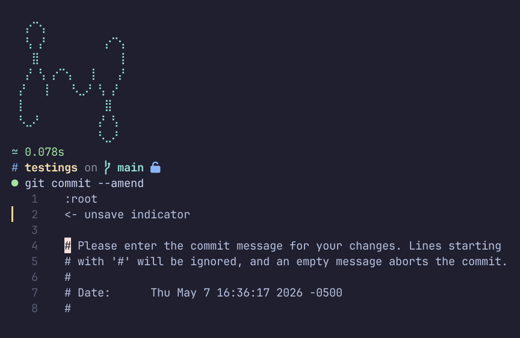

# ie (Inline Editor)

[](https://github.com/feraxhp/ie/actions/workflows/build.yml)

`ie` is a simple, fast terminal editor with syntax highlighting to edit a single file without opening a full TUI editor over the terminal. 

> [!important]
> `ie` does not aims to replace any code-editor nor an IDE, so dont spect to see 
> full AST parsing, or syntax errors... 
> > `ie` is just a plain text editor, that happends to have syntax highlitghing

Really handy to use as a git inline editor for cherry-pick, amends, merge messages, etc.



## Install

```bash
cargo install ie
```

## CLI Usage

```bash
# Open file in inline mode (default 8 lines)
ie config.toml

# Jump directly to line (e.g. from compiler, linter or systemctl error)
ie config.toml:45
ie +45 config.toml
ie config.toml +45

# Jump directly to line and column
ie config.toml:45:10
ie +45:10 config.toml
ie config.toml +45:10

# Open in fullscreen mode
ie --full config.toml:45

# Specify number of lines in inline mode
ie -l 15 +45 config.toml

# Override syntax highlighting language
ie -f toml config.custom

# Create backup before first save (e.g. /etc/fstab -> /etc/fstab.bak)
ie -b /etc/fstab
ie --backup config.toml
```

## Default Keybindings

### Navigation & Cursor

| Shortcut | Action | Description |
|---|---|---|
| <kbd>Left</kbd> | `move-left` | Move cursor left |
| <kbd>Right</kbd> | `move-right` | Move cursor right |
| <kbd>Up</kbd> | `move-up` | Move cursor up |
| <kbd>Down</kbd> | `move-down` | Move cursor down |
| <kbd>Home</kbd> | `move-line-start` | Move cursor to start of line |
| <kbd>End</kbd> | `move-line-end` | Move cursor to end of line |

### Selection

| Shortcut | Action | Description |
|---|---|---|
| <kbd>Shift</kbd> + <kbd>Left</kbd> | `select-left` | Select character to the left |
| <kbd>Shift</kbd> + <kbd>Right</kbd> | `select-right` | Select character to the right |
| <kbd>Shift</kbd> + <kbd>Up</kbd> | `select-up` | Select line upward |
| <kbd>Shift</kbd> + <kbd>Down</kbd> | `select-down` | Select line downward |
| <kbd>Shift</kbd> + <kbd>Home</kbd> | `select-line-start` | Select to start of line |
| <kbd>Shift</kbd> + <kbd>End</kbd> | `select-line-end` | Select to end of line |
| <kbd>Ctrl</kbd> + <kbd>a</kbd> | `select-all` | Select all text in file |

### History (Undo / Redo)

| Shortcut | Action | Description |
|---|---|---|
| <kbd>Ctrl</kbd> + <kbd>z</kbd> | `undo` | Undo last edit |
| <kbd>Ctrl</kbd> + <kbd>y</kbd> | `redo` | Redo edit |
| <kbd>Ctrl</kbd> + <kbd>Shift</kbd> + <kbd>z</kbd> | `redo` | Redo edit |

### Multi-cursor

| Shortcut | Action | Description |
|---|---|---|
| <kbd>Alt</kbd> + <kbd>Up</kbd> | `add-cursor-above` | Add another cursor on the line above |
| <kbd>Alt</kbd> + <kbd>Down</kbd> | `add-cursor-below` | Add another cursor on the line below |

### Editing & Line Manipulation

| Shortcut | Action | Description |
|---|---|---|
| <kbd>Backspace</kbd> | `delete-backward` | Delete character before cursor |
| <kbd>Delete</kbd> | `delete-forward` | Delete character at cursor |
| <kbd>Enter</kbd> | `insert-newline` | Insert a newline |
| <kbd>Tab</kbd> | `insert-tab` | Insert a tab indentation |
| <kbd>Shift</kbd> + <kbd>Enter</kbd> | `add-line-below` | Add an empty line below current line |
| <kbd>Ctrl</kbd> + <kbd>Enter</kbd> | `add-line-above` | Add an empty line above current line |
| <kbd>Shift</kbd> + <kbd>Delete</kbd> / <kbd>Shift</kbd> + <kbd>Backspace</kbd> | `delete-line` | Delete current line |
| <kbd>Ctrl</kbd> + <kbd>Shift</kbd> + <kbd>Down</kbd> | `clone-line-down` | Duplicate/clone current line down |
| <kbd>Ctrl</kbd> + <kbd>Shift</kbd> + <kbd>Up</kbd> | `clone-line-up` | Duplicate/clone current line up |
| <kbd>Alt</kbd> + <kbd>Shift</kbd> + <kbd>Down</kbd> | `move-selection-down` | Move selected lines (or current line) down |
| <kbd>Alt</kbd> + <kbd>Shift</kbd> + <kbd>Up</kbd> | `move-selection-up` | Move selected lines (or current line) up |
| <kbd>Shift</kbd> + <kbd>c</kbd> / <kbd>Shift</kbd> + <kbd>k</kbd> | `toggle-comments` | Toggle comment on current line or selection |

### Search Mode

| Shortcut | Action | Description |
|---|---|---|
| <kbd>Ctrl</kbd> + <kbd>f</kbd> | `search` | Open search prompt |
| <kbd>Shift</kbd> + <kbd>n</kbd> | `next-match` | Go to next search match |
| <kbd>Shift</kbd> + <kbd>p</kbd> | `prev-match` | Go to previous search match |
| <kbd>Shift</kbd> + <kbd>e</kbd> | `focus-editor` | Focus editor while search bar remains open |
| <kbd>Shift</kbd> + <kbd>s</kbd> | `focus-search` | Focus search bar input |

### General & View Controls

| Shortcut | Action | Description |
|---|---|---|
| <kbd>Ctrl</kbd> + <kbd>s</kbd> | `save-file` | Save file |
| <kbd>Ctrl</kbd> + <kbd>c</kbd> | `exit` | Exit editor |
| <kbd>Esc</kbd> | `escape` | Close search bar or clear selection |
| <kbd>F2</kbd> | `toggle-gutter` | Toggle gutter (line numbers & status marks) |
| <kbd>F3</kbd> | `toggle-wrap` | Toggle soft line wrapping |

---

## Custom Keymaps

`ie` allows full keymap customization through a `keymap.json` file placed in the user configuration directory:

| OS | Configuration Path |
|---|---|
| **Linux** | `~/.config/ie/keymap.json` |
| **macOS** | `~/Library/Application Support/ie/keymap.json` |
| **Windows** | `%APPDATA%\ie\keymap.json` |

### Configuration Modes

In `keymap.json`, the `"mode"` property defines how custom keys are applied:
- `"extend"` *(default)*: Keeps default keybindings and overrides/adds your specified keys.
- `"absolute"`: Disables all default keybindings and only enables the keys explicitly defined in `keys`.

### Example `keymap.json`

To customize your keybindings, create the folder and file:

```bash
mkdir -p ~/.config/ie
```

Then create `~/.config/ie/keymap.json`:

```json
{
  "mode": "extend",
  "keys": {
    "ctrl-w": "save-file",
    "ctrl-q": "exit",
    "ctrl-d": "delete-line",
    "alt-d": "clone-line-down",
    "ctrl-slash": "toggle-comments",
    "f5": "toggle-gutter"
  }
}
```

### Key Combination Syntax

Keys are written as hyphen-separated values: `[modifier-][modifier-]key`

- **Modifiers**: `ctrl` (or `ctr`, `control`), `alt` (or `opt`, `option`), `shift`, `super` (or `win`, `cmd`)
- **Special Keys**: `enter`, `backspace`, `tab`, `backtab`, `delete` (or `del`), `insert` (or `ins`), `esc` (or `escape`), `space`, `left`, `right`, `up`, `down`, `home`, `end`, `pageup`, `pagedown`, `f1`–`f12`, `slash` (or `/`), `underscore` (or `_`)
- **Characters**: Any letter or digit (e.g., `s`, `c`, `z`, `f`, `1`)

### Available Actions

| Action | Alias | Description |
|---|---|---|
| `save-file` | `save` | Save file to disk |
| `exit` | `quit` | Exit `ie` |
| `escape` | `esc` | Dismiss search or clear selection |
| `toggle-gutter` | - | Toggle line numbers / gutter |
| `toggle-wrap` | - | Toggle soft line wrap |
| `search` | - | Open search dialog |
| `next-match` | - | Jump to next search result |
| `prev-match` | - | Jump to previous search result |
| `focus-editor` | - | Shift focus back to editor |
| `focus-search` | - | Shift focus back to search input |
| `clone-line-down` | - | Duplicate line(s) downward |
| `clone-line-up` | - | Duplicate line(s) upward |
| `move-selection-down` | - | Shift line(s) down |
| `move-selection-up` | - | Shift line(s) up |
| `delete-line` | - | Delete line(s) |
| `add-line-below` | - | Insert blank line below |
| `add-line-above` | - | Insert blank line above |
| `toggle-comments` | - | Toggle comment markers |
| `undo` | - | Undo edit |
| `redo` | - | Redo edit |
| `select-all` | - | Select entire document |
| `insert-newline` | `newline`, `enter` | Insert newline |
| `insert-tab` | `tab` | Insert tab |
| `delete-backward` | `backspace` | Delete previous character |
| `delete-forward` | `delete` | Delete next character |
| `move-left` / `move-right` | - | Move cursor left / right |
| `move-up` / `move-down` | - | Move cursor up / down |
| `select-left` / `select-right` | - | Select left / right |
| `select-up` / `select-down` | - | Select up / down |
| `move-line-start` / `move-line-end` | `home` / `end` | Move cursor to line start / end |
| `select-line-start` / `select-line-end` | - | Select to line start / end |
| `move-doc-start` / `move-doc-end` | - | Move cursor to document start / end |
| `add-cursor-above` / `add-cursor-below` | - | Add cursor above / below |

---

## Language Highlighting & Themes

You can customize the color theme and tokenizer rules of any built-in language, or add your own custom language highlighters on demand.

This is done by placing definitions in the `languages` configuration directory:

| OS | Languages Directory |
|---|---|
| **Linux** | `~/.config/ie/languages/` |
| **macOS** | `~/Library/Application Support/ie/languages/` |
| **Windows** | `%APPDATA%\ie\languages\` |

### Directory Structure

You can organize your custom languages in two ways:

#### 1. Folder per Language (Recommended)

Place a subdirectory named after the language containing its grammar (`<lang>.toml` or `syntax.toml`) and/or theme (`theme.json`):

```
~/.config/ie/languages/
├── rust/
│   └── theme.json           # Overrides token colors for Rust
└── mylang/
    ├── mylang.toml          # Grammar definition for a new language
    └── theme.json           # Color palette for mylang
```

#### 2. Flat Files

Alternatively, place `.toml` and `.json` files directly in `languages/`:

```
~/.config/ie/languages/
├── python.json              # Overrides colors for Python
├── mylang.toml              # Grammar for mylang
└── mylang.json              # Colors for mylang
```

#### 3. Global Theme Fallback

You can also create a `global_theme.json` (or `theme.json`) directly in `languages/` to override the fallback token colors across all languages:

```json
{
  "keyword": "cyan",
  "string": "green",
  "comment": "darkgray",
  "function": "blue",
  "type": "yellow",
  "number": "magenta"
}
```

---

### Overriding an Existing Language

`ie` includes built-in syntax support for over 30 languages (Rust, Python, JavaScript, TypeScript, Go, C, C++, C#, Java, HTML, CSS, JSON, TOML, YAML, Shell, Markdown, Dockerfile, Git commits/rebases, systemd, etc.).

Any file placed in `~/.config/ie/languages/` takes strict precedence over built-in definitions:
- To customize token colors for an existing language, create `languages/<lang>/theme.json` (for example, `languages/rust/theme.json`).
- To override syntax parsing rules, provide a `<lang>.toml` file.

---

### Adding a New Language

To add support for a custom language (for example, `mylang`):

#### 1. Create the grammar file (`~/.config/ie/languages/mylang/mylang.toml`)

```toml
[meta]
name = "mylang"
extensions = ["mylang", "ml"]

[states.root]
rules = [
    # Comments starting with #
    { match = '#.*', token = "comment" },

    # Keywords
    { match = '\b(?:fn|let|if|else|return|import)\b', token = "keyword" },

    # Function declarations
    { match = '\b([a-zA-Z_]\w*)\s*(?=\()', token = "function" },

    # Strings (double and single quoted)
    { match = '"(?:[^"\\]|\\.)*"', token = "string" },
    { match = "'(?:[^'\\]|\\.)*'", token = "string" },

    # Numbers
    { match = '\b\d+(?:\.\d+)?\b', token = "number" },

    # Types
    { match = '\b(?:Int|Float|String|Bool)\b', token = "type" },

    # Operators
    { match = '[+\-*/=<>!&|]+', token = "operator" },

    # Delimiters and brackets
    { match = '[{}()\[\]]', token = "punctuation.bracket" },
    { match = '[,;:]', token = "punctuation.delimiter" },
]
```

#### 2. Create the theme file (`~/.config/ie/languages/mylang/theme.json`)

```json
{
  "keyword": "magenta",
  "function": "blue",
  "type": "yellow",
  "string": "green",
  "number": "yellow",
  "operator": "cyan",
  "comment": "darkgray",
  "punctuation.bracket": "darkgray",
  "punctuation.delimiter": "darkgray"
}
```

**Supported Color Names**: `magenta`, `blue`, `cyan`, `yellow`, `green`, `red`, `white`, `black`, `gray`, `darkgray`, `lightred`, `lightgreen`, `lightblue`, `lightyellow`, `lightmagenta`, `lightcyan`.

---

### Usage & On-Demand Highlighting

- **File Extension**: Files with extensions matching the grammar's `extensions` list or language name are highlighted automatically.
- **CLI Override**: You can force any file to use your highlighter with the `-f` / `--format` flag:
  ```bash
  ie -f mylang document.txt
  ```
- **Markdown Codeblocks**: When editing Markdown files, embedded codeblocks (e.g. ````mylang ... ````) automatically load your custom grammar and theme on demand.

---

It uses [texera](https://github.com/feraxhp/texera).
